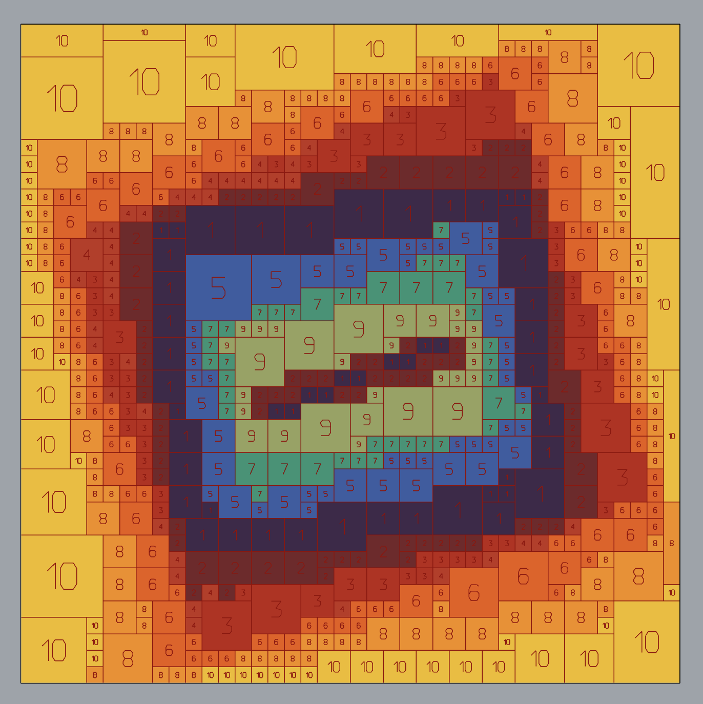
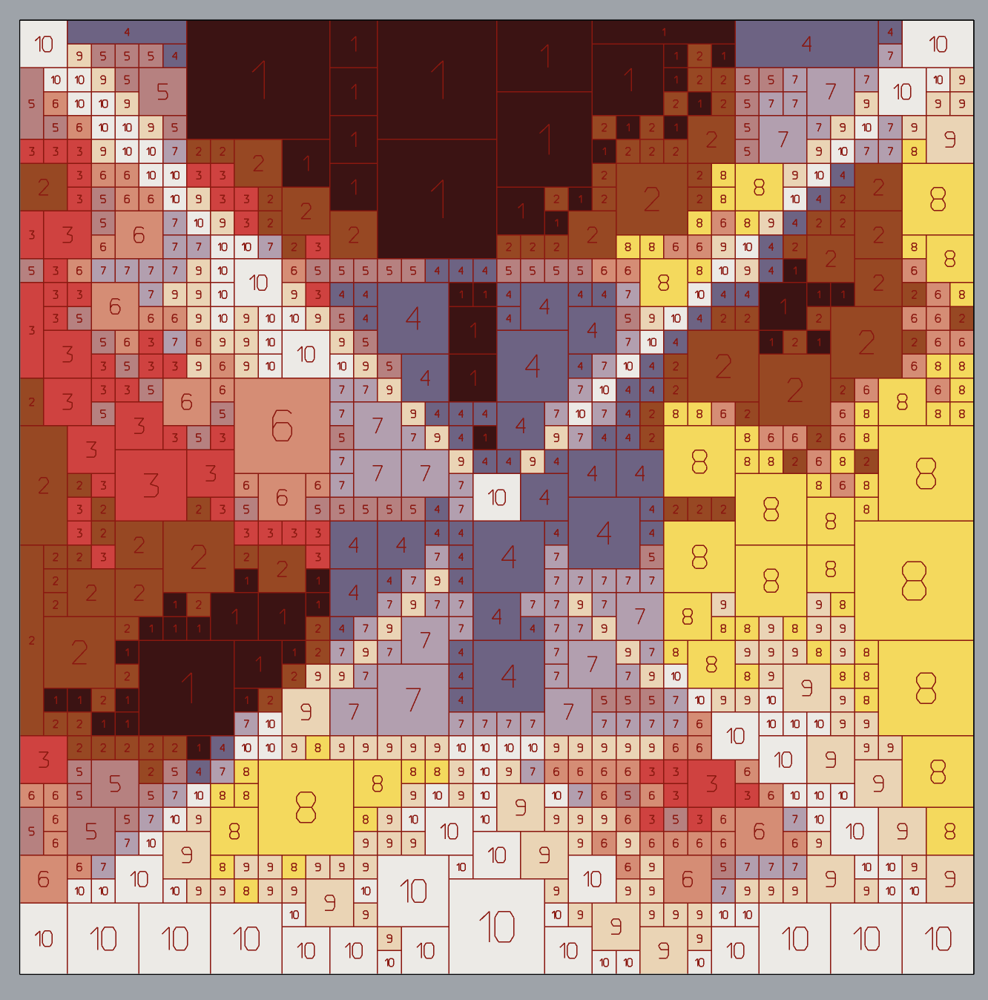
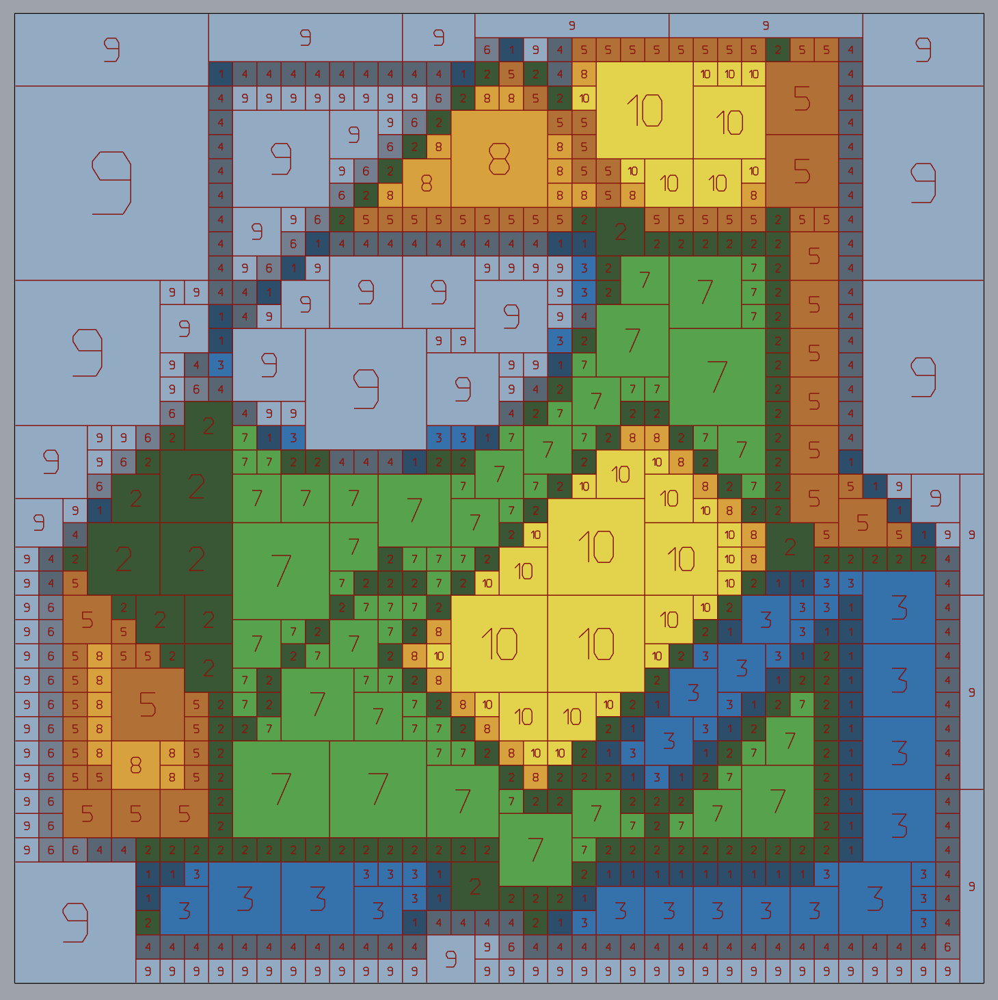
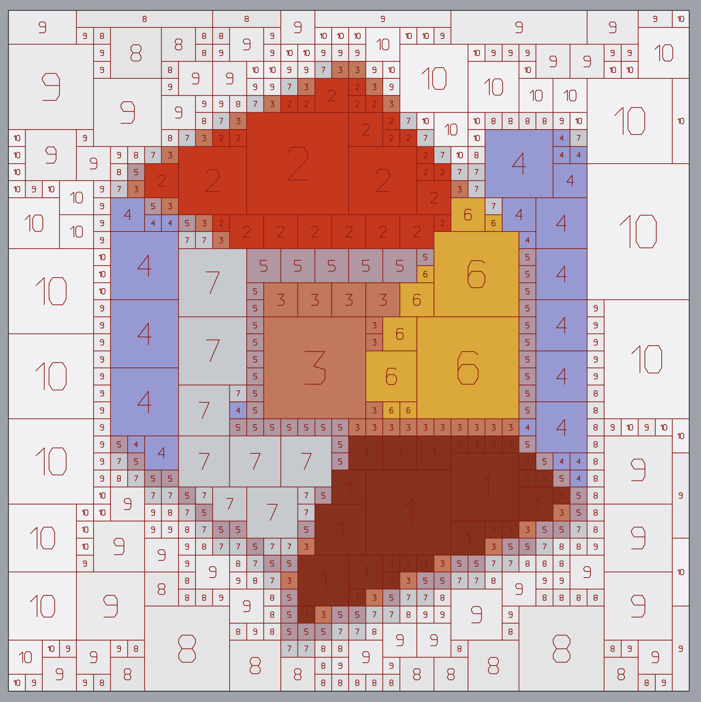
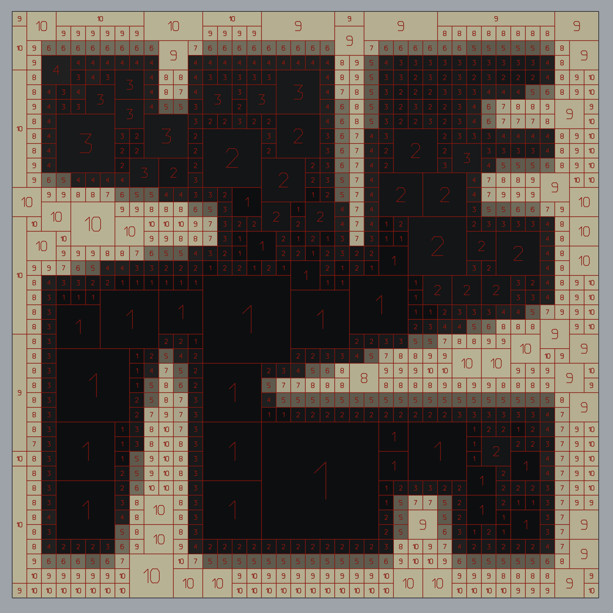
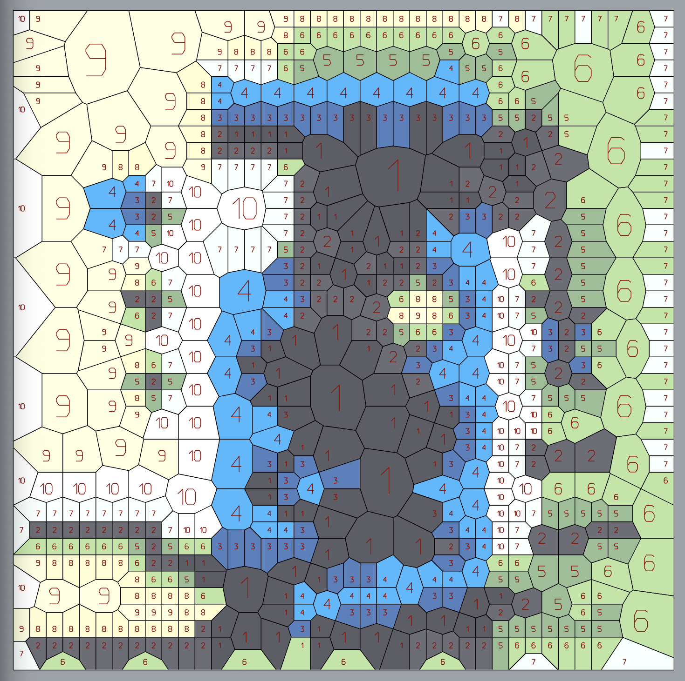
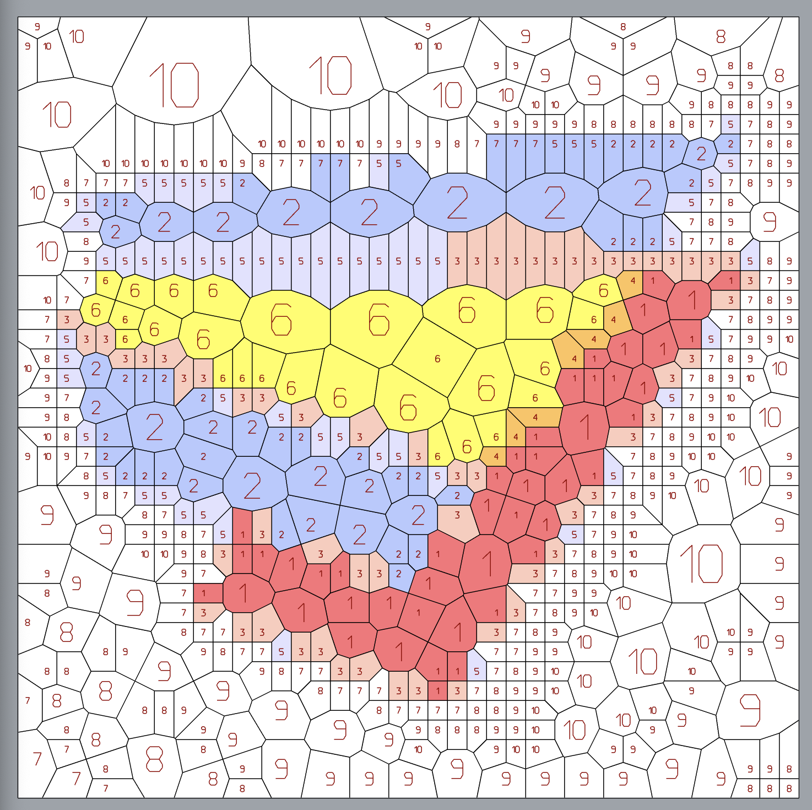
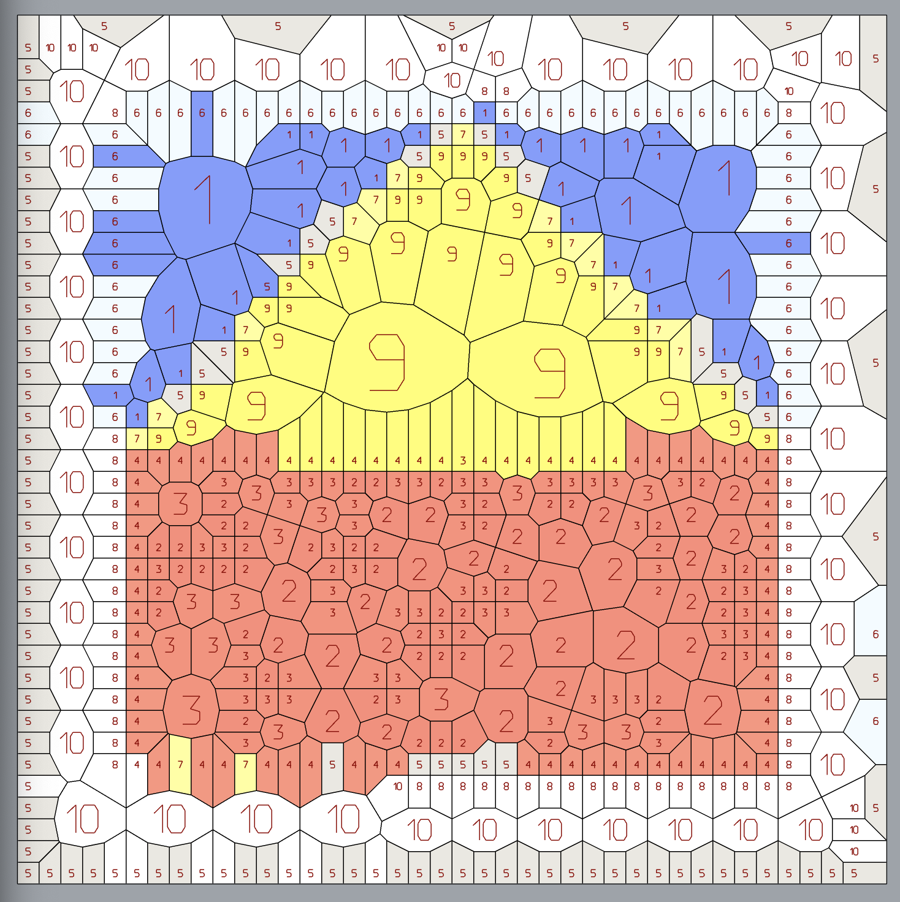

# Adaptive Tiles for Rhino + Grasshopper

A **Rhino 8 + Grasshopper Python 3 component** that converts a planar, vertex-colored mesh into an adaptive tile composition. It builds an indexed palette from the source colors, packs matching regions into differently sized squares, and produces a colored mesh, tile outlines, and centered number curves.

The component is intended for computational artwork, tile-layout studies, and numbered color maps. It runs **inside Grasshopper**, not as a standalone Python program.



## What it creates

- An indexed palette requested between **5 and 20 colors**, averaged from the source mesh. A source with fewer distinct groups may produce fewer colors.
- Square interior tiles in **0.5-inch increments**, between a minimum and maximum size supplied by a Grasshopper domain.
- Larger tiles where the indexed color remains the same; smaller pieces around color changes.
- One vertex-colored mesh, closed tile-outline curves, and fitted number curves identifying each tile's color index.
- Several packing trials to reduce tile count and boundary cuts. This is a deterministic heuristic, not a guarantee of the mathematically optimal layout.

The rectangular boundary is preserved. Tiles at the outside edge may be clipped into rectangles or pieces smaller than the requested minimum.

## Requirements

- **Rhino 8** with Grasshopper and its **Python 3** script component.
- **NumPy**. The script includes `#requirements: numpy`; Rhino installs it into its scripting environment if needed. Initial package installation may require an internet connection and additional time.
- One complete, open, **planar rectangular mesh without holes**, containing an actual color at every mesh vertex.
- A Rhino document using standard physical units. Size inputs are in **inches** and are converted to the document's units automatically.

Mesh materials, image textures, and PNG files are not read directly. Use your shader/image workflow to create a vertex-colored mesh before connecting it.

See [McNeel's Grasshopper Python guide](https://developer.rhino3d.com/guides/scripting/scripting-gh-python/) for the Python 3 component and package support.

## Grasshopper setup

1. Add a **Python 3** script component in Grasshopper.
2. Open [`lumina_indexed_squares.py`](lumina_indexed_squares.py), copy its entire contents, and paste them into the component editor. Keep both directive lines at the top.
3. Configure the four input ports below with their exact names, type hints, and **Item** access.
4. Add the three output ports named `Geo`, `Outlines`, and `Numbers`. Keep the built-in `out` output available for diagnostic timings.
5. Connect the colored mesh to `MapMesh`. Connect a **Construct Domain** component to `TileSize`, and numeric sliders to `Weave` and `ColorCount`.
6. Preview the output mesh with its vertex colors. Preview `Outlines` and `Numbers` separately as needed. A uniform-color custom preview material can obscure the mesh's indexed colors.

### Inputs

| Name | Grasshopper type hint | Access | Suggested starting value | Purpose |
| --- | --- | --- | --- | --- |
| `MapMesh` | Mesh | Item | Your vertex-colored shader mesh | Supplies the colors, plane, and rectangular bounds. |
| `TileSize` | Interval / Domain | Item | Construct Domain: **0.5 to 3.0** | Minimum and maximum nominal tile sides, in inches. |
| `Weave` | float | Item | **0.65**, slider range 0–1 | Detail sensitivity before color indexing: 0 smooths local variations; 1 retains more detail. |
| `ColorCount` | int | Item | **10**, integer slider range 5–20 | Requested number of indexed colors. |

`Weave` is retained as the input name for compatibility. It does not distort the geometry or add woven shapes. Equal indexed colors always remain eligible to merge within the size constraints.

The size domain must contain at least one half-inch increment and start at 0.5 inches or above. Bounds that are not half-inch multiples are rounded inward to the available sizes. Equal domain ends create one nominal size, with clipping only at the outside boundary.

### Outputs

| Name | Returned data | Use |
| --- | --- | --- |
| `Geo` | One `Rhino.Geometry.Mesh` | All tile faces, with indexed vertex colors. |
| `Outlines` | List of closed `PolylineCurve` objects | One closed boundary per tile, in mesh-face order. |
| `Numbers` | Flat list of `PolylineCurve` objects | Centered and fitted color-index digits. A two-digit label contributes **two curves**, so this list is not one item per tile. |
| `out` | Built-in script text output | Tile count, actual color count, and phase timings. Connect a Panel. |

Indices run from 1 to the actual palette size, sorted by palette brightness. They can change when the source or controls change. The mesh's vertex colors carry the palette; a separate palette-table output is not included.

## How the component works

1. Bulk-read mesh coordinates, faces, and vertex colors.
2. Locate four samples in each half-inch analysis cell using vectorized triangle calculations. Quads are sampled as triangles ABC and ACD.
3. Average samples over the minimum-size tile grid. Apply the `Weave` detail setting before classifying colors.
4. Build the indexed palette, using physical-area-weighted source RGB averages for the displayed colors.
5. Pack same-index regions using multiple size limits and scan directions, choosing a result with fewer tiles and then fewer clipped pieces.
6. Create the colored mesh, exact tile outlines, and scaled digit curves.

Geometry sampling, colors, and layouts are cached separately per component instance. Changing only the palette count or tile controls reuses the mesh analysis. Changing source colors reuses sample locations while updating the color data.

## Performance and boundaries

The script reports timings rather than promising a fixed runtime on every mesh or machine. It has a **13-second cooperative working-time guard**; a native Rhino or NumPy operation may exceed that time before the next check. Initial Python/package startup is additional. If the guard triggers, the component reports an error and returns no partial geometry.

The fixed half-inch analysis grid is limited to **16,000 cells**. Increasing the minimum tile size does not remove this analysis limit. Very elongated source triangles also have a bounded sampling-work limit. If necessary, use a more uniform source mesh or process smaller map sections.

Details finer than the sampling grid may be missed. The output is planar geometry: no thickness, grout allowance, fabrication tolerance, ticks, or automatic edge fading are added. Neighboring tile outlines contain duplicate shared edges; remove duplicates before workflows that require a single cutting path.

## Example gallery

These eight plates were supplied as examples from the project's Rhino + Grasshopper workflow. The PNGs are included unchanged and can be opened at full resolution. They are visual examples, not source mesh inputs; this repository does not include a wired `.gh` definition or the meshes used to make them.

### Square-tile studies

Plate 04 appears above. The following plates show the square-cell layout used by the included component.

| Plate 03 | Plate 10 |
| --- | --- |
| [](examples/Plate_03.png) | [](examples/Plate_10.png) |

| Plate 13 | Plate 15 |
| --- | --- |
| [](examples/Plate_13.png) | [](examples/Plate_15.png) |

### Related polygonal studies

Plates 17–19 show irregular polygonal variations from the broader project. They are included as supplied references. **The Python script in this repository generates square interior tiles; it does not contain the additional operations used for these polygonal shapes.**

| Plate 17 | Plate 18 | Plate 19 |
| --- | --- | --- |
| [](examples/Plate_17.png) | [](examples/Plate_18.png) | [](examples/Plate_19.png) |

## Repository contents

```text
lumina_indexed_squares.py   Complete Grasshopper Python 3 component script
examples/                  Eight supplied PNG example plates
README.md                  Setup, controls, behavior, and gallery
```
